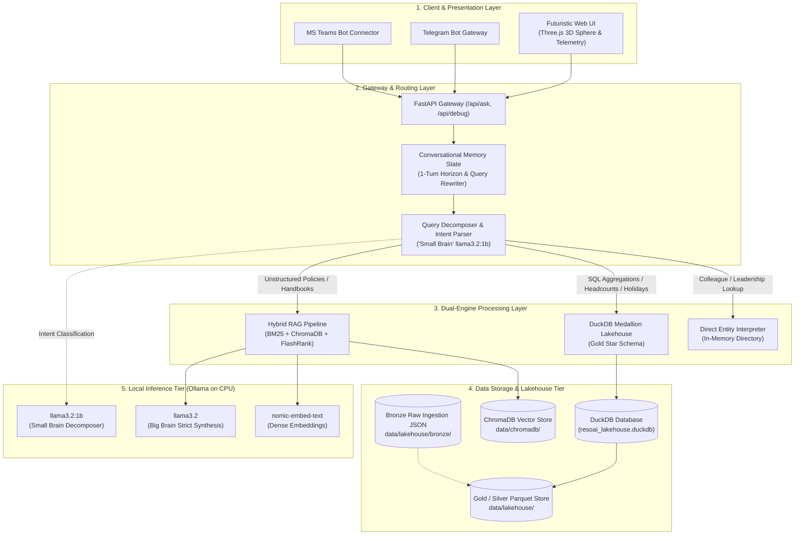
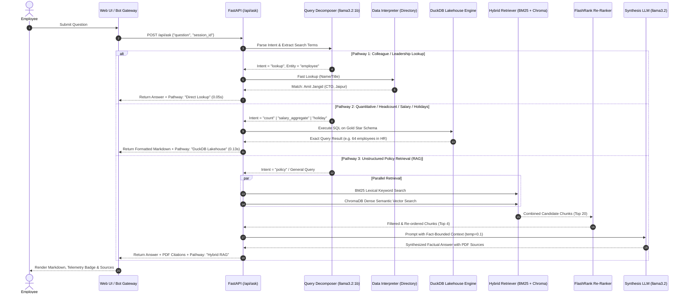

# ResoAI — System Architecture & Technical Specifications

> **Autonomous Self-Correcting Agentic CRAG & Embedded DuckDB Medallion Lakehouse**  
> Enterprise conversational intelligence assistant built for FiftyFive Technologies.

---

## 1. 🏗️ System Overview

ResoAI is an on-premises, enterprise-grade conversational AI assistant designed to eliminate hallucinations on quantitative queries while delivering deep semantic retrieval for corporate knowledge. 

Traditional enterprise chatbots fail when answering mathematical, headcount, or relational queries because Large Language Models (LLMs) cannot execute deterministic calculations over unstructured text chunks. ResoAI solves this challenge through a **Dual-Engine Architectural Pattern**:

1. **Deterministic Analytical Fast-Path (DuckDB Medallion Lakehouse):** Headcounts, salary analytics, organizational hierarchies, and company holiday schedules are routed directly to an embedded DuckDB Star Schema, returning 100% mathematically accurate responses in **under 150 milliseconds**.
2. **Self-Correcting Agentic Hybrid RAG (CRAG Pipeline):** Unstructured text queries (company policies, ISO procedures, contracts, benefits) are handled by a multi-stage retrieval pipeline combining lexical keyword matching, dense vector embeddings, and cross-encoder re-ranking.
3. **100% Local CPU Execution:** Runs completely offline using Ollama (`llama3.2` and `llama3.2:1b`) on local CPU hardware—guaranteeing zero corporate data leakage, zero cloud token costs, and air-gapped security compliance.

---

## 2. 🧩 System Components

### 2.1 Query Decomposer & Intent Parser ("Small Brain")
* **Component:** [`src/rag/query_decomposer.py`](src/rag/query_decomposer.py)
* **Model:** `llama3.2:1b` (1 billion parameter quantized model running on CPU).
* **Role:** Parses incoming raw user queries into a typed JSON `QueryPlan`. It identifies:
  * **Intent:** `count`, `list`, `lookup`, `policy`, `salary_aggregate`, or `holiday_query`.
  * **Target Entities:** `employee`, `department`, `project`, `holiday`, or `policy`.
  * **Cleaned Search Terms:** Strips conversational noise words and normalizes entity variations (e.g., expanding `"HR"` → `"Human Resource"`, `"AI"` → `"Artificial Intelligence"`).
* **Routing Decision:** Bypasses LLM generation if the intent is mathematical or analytical.

### 2.2 DuckDB Medallion Lakehouse Engine
* **Component:** [`src/lakehouse/pipeline.py`](src/lakehouse/pipeline.py) & [`src/lakehouse/query_engine.py`](src/lakehouse/query_engine.py)
* **Engine:** Embedded DuckDB v2.0 with columnar execution.
* **Architecture:**
  * **Bronze Layer:** Immutable append-only raw JSON ingestion files capturing audit metadata (`ingested_at`, `source`, raw entity arrays).
  * **Silver Layer:** Deduplicated, validated, and type-cast Apache Parquet datasets (`silver_employees`, `silver_departments`, `silver_projects`, `silver_holidays`).
  * **Gold Layer (Star Schema):** 
    * Fact Table: `fact_employee_allocations` (salary, years of experience, performance ratings, leave balances, project allocation %).
    * Dimension Tables: `dim_employee`, `dim_department`, `dim_project`, `dim_holiday`.
    * Materialized Analytical Marts: `gold_dept_summary`, `gold_city_headcount`, `gold_project_staffing`.
* **Latency:** < 150 milliseconds query execution time for complex multi-table SQL joins and aggregations.

### 2.3 Agentic Hybrid RAG Pipeline ("Big Brain")
* **Component:** [`src/rag/chain.py`](src/rag/chain.py)
* **Model:** `llama3.2` (3 billion parameter model set to strict temperature 0.1).
* **Multi-Stage Retrieval:**
  1. **Lexical Keyword Search:** [`Rank-BM25`](https://github.com/dorianbrown/rank_bm25) index over tokenized policy documents for exact keyword matching (policy clause numbers, acronyms, specific phrases).
  2. **Dense Vector Search:** [`ChromaDB`](https://www.trychroma.com/) storing 768-dimensional embeddings generated by `nomic-embed-text`.
  3. **Reciprocal Fusion & Re-Ranking:** [`FlashRank`](https://github.com/PrithivirajDamodaran/FlashRank) neural cross-encoder (`ms-marco-TinyBERT-L-2-v2`) re-ranks the combined top-20 candidates down to the top-4 most semantically dense context passages.
* **Strict Factual Synthesis:** The prompt enforces strict citation boundaries: *"Answer ONLY based on the provided context. If not found, reply that it is not documented in company records."*

### 2.4 Direct Entity Directory Resolver
* **Component:** [`src/rag/data_interpreter.py`](src/rag/data_interpreter.py)
* **Role:** High-speed in-memory JSON resolver for authentic staff directory lookups (e.g., *"Who is Amit Jangid?"* or *"Who is the CTO?"*). Returns the matched employee profile in **< 50 milliseconds**.

### 2.5 Presentation & Interface Tier
* **Web UI:** Responsive dark-mode glassmorphic console powered by Three.js (interactive 3D revolving synaptic sphere), Marked.js markdown rendering, and live compute telemetry badges.
* **Bot Gateways:** Async integration runners for Telegram Bot (`python-telegram-bot` v22) and Microsoft Teams Bot Framework.

---

## 3. 🔄 End-to-End Data Flow

### 3.1 Request Lifecycle Sequence Diagram

### 3.2 Data Ingestion & Medallion Pipeline Flow

```mermaid
flowchart LR
    RawJSON["Source JSONs & PDFs\n(HR, Holidays, Projects)"] --> Bronze["Bronze Layer\n(Immutable Raw Payloads\nwith Ingest Timestamps)"]
    Bronze --> Clean["Cleaning & Type-Casting\n(Schema Validation, Deduplication)"]
    Clean --> Silver["Silver Layer\n(Cleaned Parquet Tables)"]
    Silver --> Modeling["Star Schema Modeling\n(Surrogate Keys & Metrics)"]
    Modeling --> Gold["Gold Layer\n(Fact & Dimensions)"]
    Gold --> Sync["Vector Sync Bridge\n(Dual-Sync Holidays & Metadata)"]
    Sync --> Chroma[("ChromaDB\nVector Store")]
```

---

## 4. 💻 Technology Stack

| Layer / Domain | Technology / Library | Version / Model | Architectural Purpose |
|---|---|---|---|
| **Local LLM Engine** | [Ollama](https://ollama.com) | `v0.6.2+` | Standalone local CPU inference runtime for quantized models |
| **Synthesis LLM (Big Brain)** | Meta Llama 3.2 | `llama3.2:3b` | Fact-bounded semantic synthesis at temperature 0.1 |
| **Intent Parser (Small Brain)** | Meta Llama 3.2 | `llama3.2:1b` | Lightweight, sub-second query intent decomposition |
| **Dense Embeddings** | Nomic Embed Text | `nomic-embed-text:v1.5` | 768-dimensional dense vector embeddings for documents |
| **Analytical Lakehouse** | [DuckDB](https://duckdb.org) | `v2.0.0` | Embedded columnar OLAP engine for sub-millisecond SQL analytics |
| **Columnar Storage Format** | [Apache Parquet](https://parquet.apache.org) | Snappy-compressed | High-performance columnar storage for Silver & Gold layers |
| **Vector Database** | [ChromaDB](https://www.trychroma.com) | `v1.5.9` | Persistent local vector store for semantic embeddings |
| **Lexical Keyword Search** | Rank-BM25 | `v0.2.2` | Exact keyword matching over tokenized corporate documents |
| **Neural Re-Ranking** | FlashRank | `v0.2.10` | Cross-encoder model (`ms-marco-TinyBERT-L-2-v2`) re-ranking |
| **API Web Framework** | [FastAPI](https://fastapi.tiangolo.com) | `v0.136.1` | High-performance asynchronous REST API server |
| **ASGI Web Server** | [Uvicorn](https://www.uvicorn.org) | `v0.47.0` | Production ASGI web server running on port 8000 |
| **Settings & Schemas** | [Pydantic](https://docs.pydantic.dev) | `v2.13.4` | Strictly typed environment configuration and query contracts |
| **Web UI Visuals** | Three.js & HTML5 Canvas | `r128` | Real-time ambient 3D revolving synaptic neural globe |
| **Markdown Rendering** | Marked.js | `v12.0` | Client-side safe Markdown and table parsing |
| **Automated Testing** | Pytest & pytest-asyncio | `v9.0.3` | Unit and integration test suite (`make test`, `make test-fast`) |
| **Linter & Code Formatter** | Ruff | `v0.15.14` | High-speed Python linter and code formatting tool |
| **Audit Compliance** | FiftyFive AI Standards | [Audit Tool](https://github.com/FiftyfiveTech/ai-workflow-audit) | Canonical `AGENTS.md`, AI policy guardrails, and CI hooks |

---

## 5. 🛡️ Security & Privacy Architecture

* **Air-Gapped Local Operation:** No company employee records, salaries, or internal policies are transmitted to external cloud APIs or third-party hosted endpoints.
* **No Telemetry Leakage:** Ollama runs in local offline mode without external analytic tracking.
* **Read-Only Database Querying:** The DuckDB query engine implements restricted, read-only analytical execution pipelines preventing unauthorized data mutations.
* **Audit Governance:** All codebase changes adhere to FiftyFive Technologies AI workflow standards, requiring automated test passing (`make test-fast`) prior to production deployment.

---
*Maintained by FiftyFive Technologies — Enterprise AI & Lakehouse Practice*
