# ResoAI — Enterprise Conversational Intelligence Assistant

> **Autonomous Self-Correcting Agentic CRAG + Embedded DuckDB Medallion Lakehouse**  
> Developed for FiftyFive Technologies. Runs 100% locally on CPU via [Ollama](https://ollama.com) with zero cloud token costs, zero hallucinations on math, and strict corporate data privacy.

---

## 🚀 Overview & Architecture

ResoAI bridges the gap between **unstructured corporate policies** (PDFs, handbooks, ISO procedures) and **structured quantitative data** (headcounts, salary distributions, holidays, project staffing) through a **Dual-Engine Architecture**:

```mermaid
flowchart TD
    User["User (Web UI / Telegram / Teams)"] --> Decomposer["Query Decomposer & Intent Parser ('Small Brain' llama3.2:1b)"]
    
    Decomposer -->|"Quantitative / Headcounts / Salaries / Holidays"| Lakehouse["DuckDB Medallion Lakehouse\n(Gold Star Schema)"]
    Decomposer -->|"Unstructured Policies / ISO / Handbooks"| HybridRAG["Agentic Hybrid RAG Pipeline\n(BM25 + ChromaDB + FlashRank)"]
    Decomposer -->|"Direct Staff / Leadership Lookup"| Directory["Direct Entity Interpreter\n(In-Memory Directory)"]
    
    Lakehouse -->|"Sub-200ms Deterministic SQL"| Answer["Accurate Answer with Sources & Telemetry"]
    HybridRAG -->|"Strict Synthesis via Llama 3.2"| Answer
    Directory -->|"50ms Instant Match"| Answer
```



### 🧠 1. The Dual-Brain System
* **Small Brain (`llama3.2:1b`):** Fast, low-latency intent parser that dynamically decomposes questions into search plans without brittle regexes.
* **Big Brain (`llama3.2` at temp 0.1):** Strict, fact-bounded synthesis engine that extracts answers directly from retrieved documents with source citations.

### 🏛️ 2. DuckDB Medallion Lakehouse
* **Bronze Layer:** Ingests raw JSON payloads into immutable append-only storage with audit timestamps.
* **Silver Layer:** Cleans, deduplicates, schema-validates, and exports optimized Apache Parquet tables.
* **Gold Layer:** Star Schema with central fact table (`fact_employee_allocations`) joined against dimensional tables (`dim_employee`, `dim_department`, `dim_project`, `dim_holiday`) and pre-computed analytical marts (`gold_dept_summary`, `gold_city_headcount`, `gold_project_staffing`).

### 🔍 3. Agentic Hybrid RAG
* **Two-Stage Search:** Combines statistical keyword retrieval ([`Rank-BM25`](src/rag/chain.py)) with dense vector embeddings ([`ChromaDB`](src/rag/chain.py)) using `nomic-embed-text`.
* **FlashRank Neural Re-ranking:** Cross-encoder neural re-ranker eliminates irrelevant context chunks to maximize factual accuracy.

---

## 💻 System Requirements & Prerequisites

* **OS:** Linux (Ubuntu 20.04+ recommended), macOS, or Windows via WSL2
* **Python:** `Python 3.10` or higher
* **Memory:** Minimum 8 GB RAM (16 GB recommended for CPU inference)
* **System Packages:** `git`, `curl`, `poppler-utils` (for PDF processing)
* **LLM Engine:** [Ollama](https://ollama.com) installed and running locally

---

## 🛠️ Step-by-Step Setup Guide

### Step 1: Clone the Repository
```bash
git clone https://github.com/Ashu199755tech/ResoAI_Telegram_Bot.git
cd ResoAI_Telegram_Bot
```

### Step 2: Install & Pull Ollama Models
Ensure the Ollama daemon is running (`ollama serve`), then pull the required models:
```bash
# 1. Big Brain: Final factual answer synthesis
ollama pull llama3.2

# 2. Small Brain: Ultra-fast intent parser & query decomposer
ollama pull llama3.2:1b

# 3. Dense Vector Embeddings: For ChromaDB semantic search
ollama pull nomic-embed-text
```

### Step 3: Set Up Python Virtual Environment & Dependencies
```bash
# Install system dependency for PDF text extraction (Debian/Ubuntu)
sudo apt update && sudo apt install -y poppler-utils

# Create virtual environment and install dependencies
make setup
```
*Or manually:*
```bash
python3 -m venv venv
source venv/bin/activate
pip install --upgrade pip
pip install -r requirements.txt
```

### Step 4: Build DuckDB Lakehouse & Ingest Data
Build the DuckDB Bronze, Silver, and Gold Star Schema tables, and sync company holidays into ChromaDB:
```bash
make lakehouse
```
*Or manually:*
```bash
./venv/bin/python scripts/build_lakehouse.py --sync-holidays
```

---

## ▶️ Running ResoAI

### 1. Launch the Web Chatbot Server
Start the FastAPI server hosting the neural web interface and REST API on port `8000`:
```bash
make run
```
*Or manually:*
```bash
./venv/bin/python scripts/run_web.py --port 8000
```

### 2. Access the Application
Open your web browser and navigate to:
👉 **[http://localhost:8000](http://localhost:8000)**

You will see the futuristic dark-mode console with the revolving 3D neural synaptic globe, live compute telemetry badges, and interactive source citations.

---

## 🐳 Alternative Setup: Docker Compose

If you prefer running everything in isolated containers without setting up Python locally:

```bash
docker-compose up -d
```
* Spawns `resoai-app` on port `8001`.
* Spawns `resoai-ollama` and automatically pulls required models on startup.

---

## 📋 Development & Maintenance Commands (`Makefile`)

All common workflows are automated via headless `make` targets:

| Command | Description |
|---|---|
| `make setup` | Create `venv` and install all Python dependencies |
| `make run` | Launch the ResoAI web chatbot server on port 8000 |
| `make lakehouse` | Build DuckDB Bronze/Silver/Gold Lakehouse & sync holidays |
| `make test` | Run complete automated test suite (`pytest -v`) |
| `make test-fast` | Run targeted Lakehouse & API unit tests |
| `make lint` | Check code quality and formatting with Ruff |
| `make format` | Automatically fix and format code with Ruff |
| `make clean` | Remove cache files, pytest artifacts, and build directories |

### Generate Visual Presentation PDFs
```bash
# Generate 3-page sample table presentation PDF for stakeholders:
./venv/bin/python scripts/generate_sample_tables_pdf.py
# -> docs/duckdb_sample_data.pdf

# Generate complete 9-page technical schema catalog:
./venv/bin/python scripts/generate_duckdb_pdf.py
# -> docs/duckdb_tables_catalog.pdf
```

---

## 🧪 Sample Queries to Test the System

Once the server is running on `http://localhost:8000`, test these questions to verify all distinct pathways:

| # | Question | Pathway | Expected Output | Execution Speed |
|---|---|---|---|---|
| **1** | *"Who is Amit Jangid?"* | `Direct Entity Lookup` | Identifies Amit Jangid (EMP1025) as Chief Technology Officer in Technology (Jaipur). | **~0.05s** |
| **2** | *"How many employees are in HR?"* | `DuckDB Medallion Lakehouse` | Executes SQL on Gold Star Schema: returns exact count of 64 employees. | **~0.13s** |
| **3** | *"When is Diwali in 2026?"* | `DuckDB Medallion Lakehouse` | Queries `dim_holiday`: Sunday, November 8, 2026 (Weekend Holiday). | **~0.10s** |
| **4** | *"What is the probation period policy for new employees?"* | `Agentic Hybrid RAG` | Retrieves official company PDF policy: 3 months for experienced professionals. | CPU Inference |

---

## 🔌 Core API Endpoints

### 1. `/api/ask` (POST)
Primary conversational query endpoint with memory support.
```bash
curl -X POST http://localhost:8000/api/ask \
     -H "Content-Type: application/json" \
     -d '{"question": "How many employees are in HR?", "session_id": "session_001"}'
```

### 2. `/api/health` (GET)
System health check endpoint.
```bash
curl http://localhost:8000/api/health
# Response: {"status":"ok","service":"ResoAI"}
```

### 3. `/api/debug` (POST)
Returns query decomposer plan, retrieved candidate chunks, and routing pathways without calling final LLM synthesis.
```bash
curl -X POST http://localhost:8000/api/debug \
     -H "Content-Type: application/json" \
     -d '{"question": "Who is Amit Jangid?"}'
```

---

## 📂 Project Directory Map

```text
├── src/
│   ├── main.py                 # FastAPI server entrypoint & web routes
│   ├── config.py               # Centralized Pydantic application settings
│   ├── rag/
│   │   ├── chain.py            # Hybrid Search (BM25 + ChromaDB + FlashRank) & synthesis
│   │   ├── query_decomposer.py # Small Brain LLM intent parser (llama3.2:1b)
│   │   ├── data_interpreter.py # Deterministic in-memory entity scanner
│   │   └── memory.py           # Conversational memory state & query rewriter
│   └── lakehouse/
│       ├── pipeline.py         # Medallion ETL pipeline (Bronze -> Silver -> Gold Parquet)
│       ├── query_engine.py     # Sub-millisecond analytical SQL engine for Star Schema
│       ├── generator.py        # Synthetic test data & authentic holiday generator
│       └── vector_sync.py      # Dual-sync bridge between DuckDB Gold and ChromaDB
├── data/
│   ├── lakehouse/              # DuckDB database (resoai_lakehouse.duckdb) & Parquet files
│   ├── chromadb/               # Persistent dense vector store
│   ├── employees.json          # Authentic employee directory source of truth
│   └── holidays.json           # Official 2026 FiftyFive Technologies holiday calendar
├── docs/
│   ├── duckdb_sample_data.pdf  # 3-page presentation PDF of DuckDB sample tables
│   ├── duckdb_tables_catalog.pdf # 9-page technical schema & data catalog
│   └── ai-policy.md            # AI workflow governance & human-approval guidelines
├── scripts/
│   ├── run_web.py              # Web chatbot runner with 3D neural visualization
│   ├── build_lakehouse.py      # CLI runner to build Lakehouse & sync holidays
│   └── generate_sample_tables_pdf.py # PDF sample generator
├── tests/                      # Automated unit and integration test suite
├── Makefile                    # Developer commands (run, test, lint, lakehouse)
├── AGENTS.md                   # Canonical AI agent instructions
└── README.md                   # Project documentation & setup guide
```

---

## 🛡️ AI Governance & Audit Compliance

This repository complies with the FiftyFive Technologies [AI Workflow Audit](https://github.com/FiftyfiveTech/ai-workflow-audit) standards:
* **Canonical Agent Guide:** [`AGENTS.md`](AGENTS.md) (< 200 lines, single source of truth)
* **Cursor & Claude IDE Rules:** [`.cursorrules`](.cursorrules), [`CLAUDE.md`](CLAUDE.md), [`.claude/settings.json`](.claude/settings.json)
* **Governance Policies:** [`docs/ai-policy.md`](docs/ai-policy.md), [`docs/human-approval-list.md`](docs/human-approval-list.md)
* **Automated CI & PR Templates:** [`.github/pull_request_template.md`](.github/pull_request_template.md), [`.github/CODEOWNERS`](.github/CODEOWNERS)
* **Reproducible Test Verification:** `make test-fast` passing before every commit.

---
*Maintained by FiftyFive Technologies — Enterprise AI & Lakehouse Practice*
