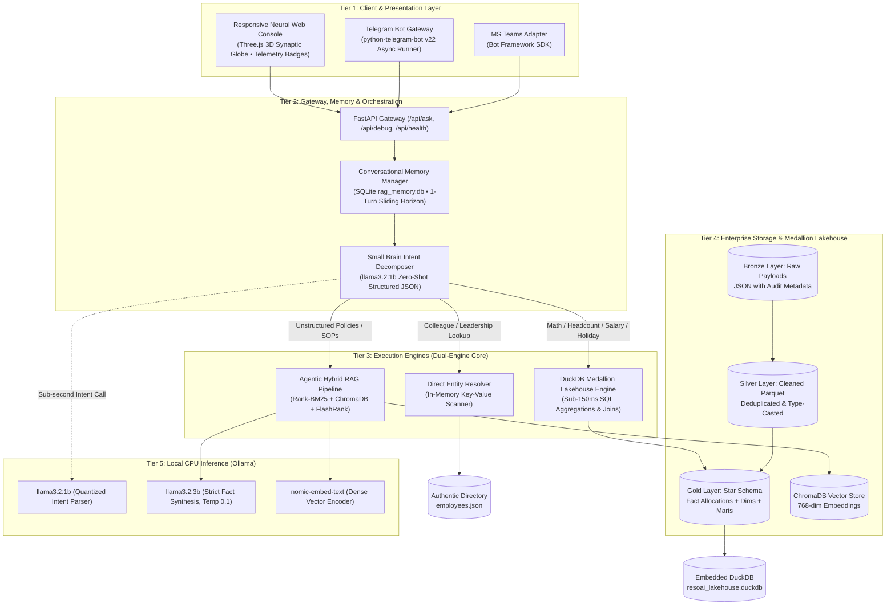
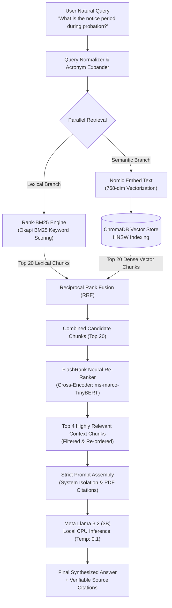
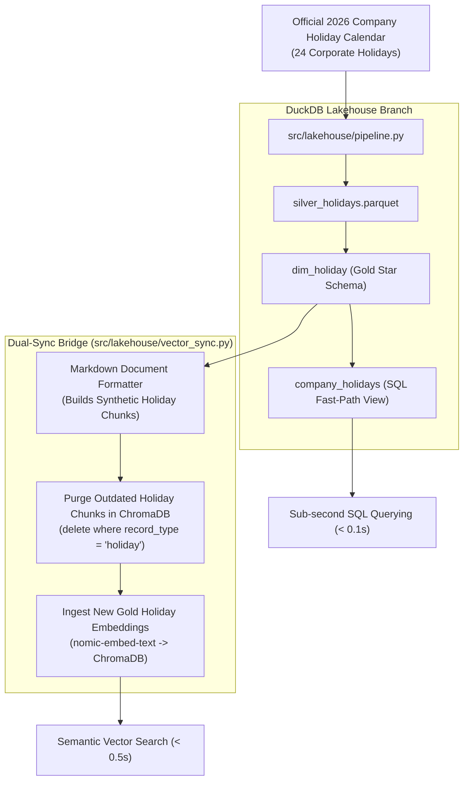

# ResoAI: Comprehensive Enterprise System Architecture & Technical Specification

> **Classification:** Enterprise Architectural Whitepaper & Deep-Dive Technical Blueprint  
> **System:** ResoAI — Autonomous Self-Correcting Agentic CRAG & Embedded DuckDB Medallion Lakehouse  
> **Organization:** FiftyFive Technologies — Enterprise AI & Lakehouse Practice  
> **Version:** 2.4.0 (Production Architecture)  
> **Deployment Model:** 100% On-Premises / Air-Gapped CPU Inference  

---

## Table of Contents
1. [Executive Summary & Architectural Paradigm](#1-executive-summary--architectural-paradigm)
2. [The Core Problem Formulation: Why Standard Enterprise RAG Fails](#2-the-core-problem-formulation-why-standard-enterprise-rag-fails)
3. [High-Level System Topology & Core Invariants](#3-high-level-system-topology--core-invariants)
4. [Tiered "Small Brain / Big Brain" Intelligence Routing Engine](#4-tiered-small-brain--big-brain-intelligence-routing-engine)
5. [The DuckDB Medallion Lakehouse Architecture](#5-the-duckdb-medallion-lakehouse-architecture)
6. [Self-Correcting Agentic Hybrid RAG (CRAG) Pipeline](#6-self-correcting-agentic-hybrid-rag-crag-pipeline)
7. [Direct Entity & Staff Directory Resolver Tier](#7-direct-entity--staff-directory-resolver-tier)
8. [Conversational Memory & Context Window Management](#8-conversational-memory--context-window-management)
9. [Data Engineering & Dual Vector Sync Bridge](#9-data-engineering--dual-vector-sync-bridge)
10. [Frontend Neural Interface & Compute Telemetry](#10-frontend-neural-interface--compute-telemetry)
11. [End-to-End Request Lifecycles & Sequence Blueprints](#11-end-to-end-request-lifecycles--sequence-blueprints)
12. [Complete Technical Stack & Component Specifications](#12-complete-technical-stack--component-specifications)
13. [Security Architecture, AI Governance & Guardrails](#13-security-architecture-ai-governance--guardrails)
14. [Testing Strategy & Verification Architecture](#14-testing-strategy--verification-architecture)
15. [Operational Runbook, Known Limitations & Strategic Roadmap](#15-operational-runbook-known-limitations--strategic-roadmap)

---

## 1. Executive Summary & Architectural Paradigm

Modern enterprise knowledge systems are fundamentally bifurcated into two disjoint information worlds:
1. **Unstructured Human Knowledge:** Policy documents, standard operating procedures (SOPs), ISO certifications, employee benefit guides, and legal contracts stored as long-form PDFs, Word documents, and intranet wikis.
2. **Structured Relational Analytics:** Headcounts, organizational structures, compensation grades, department hierarchies, project allocations, and corporate holiday calendars stored in relational databases, analytical data warehouses, and HRMS tables.

Traditional conversational AI assistants treat all enterprise questions as a homogeneous unstructured retrieval problem. They dump document chunks into vector stores and prompt a single monolithic Large Language Model (LLM) to read and answer. While this paradigm succeeds on high-level descriptive queries, it catastrophically collapses when confronted with quantitative, mathematical, or relational queries—hallucinating headcount figures, miscalculating department averages, and leaking confidential data to third-party cloud APIs.

**ResoAI** is engineered around a fundamentally distinct architectural paradigm: the **Dual-Engine Enterprise Architecture**.

```
                           ┌──────────────────────────────────────────────┐
                           │            Employee Natural Query            │
                           └──────────────────────┬───────────────────────┘
                                                  │
                                                  ▼
                           ┌──────────────────────────────────────────────┐
                           │        Tier 1: Intent & Routing Tier         │
                           │   Small Brain (llama3.2:1b) + Decomposer    │
                           └───────┬──────────────┬──────────────┬────────┘
                                   │              │              │
                   Quantitative    │              │ Identity     │ Qualitative
                   & Analytics     │              │ Lookup       │ Policies
                                   ▼              ▼              ▼
                     ┌──────────────────┐  ┌──────────────┐  ┌──────────────────┐
                     │  Engine Alpha:   │  │ Engine Beta: │  │  Engine Gamma:   │
                     │  DuckDB Gold     │  │  In-Memory   │  │  Agentic Hybrid  │
                     │  Star Schema     │  │  Directory   │  │  RAG + FlashRank │
                     │  (OLAP SQL)      │  │  Resolver    │  │  + Big Brain     │
                     └─────────┬────────┘  └──────┬───────┘  └────────┬─────────┘
                               │                  │                   │
                               │ < 150ms          │ < 50ms            │ 15 - 30s
                               │ 100% Exact Math  │ Key-Value Match   │ Strict Factual
                               ▼                  ▼                   ▼
                           ┌──────────────────────────────────────────────┐
                           │      Unified Context & Telemetry Payload     │
                           │  Answer + Latency Badge + Pathway + Citations│
                           └──────────────────────────────────────────────┘
```

By decoupling quantitative aggregations from unstructured qualitative synthesis, ResoAI guarantees:
* **Zero Mathematical Hallucinations:** Quantitative metrics are resolved via deterministic SQL queries running over an embedded DuckDB Gold Star Schema.
* **Strict Fact-Bounded Policy Retrieval:** Unstructured document queries are filtered through a multi-stage Hybrid Retrieval (BM25 + Dense ChromaDB Vector + FlashRank Neural Re-ranking) pipeline and synthesized by Meta Llama 3.2 at temperature 0.1.
* **100% On-Premises Air-Gapped Privacy:** The entire infrastructure—from embeddings to vector indexing, analytical querying, and LLM reasoning—operates locally on commodity CPU hardware with zero external cloud egress.

---

## 2. The Core Problem Formulation: Why Standard Enterprise RAG Fails

To understand ResoAI's design choices, one must analyze the mathematical and architectural failure modes of conventional Retrieval-Augmented Generation (RAG) systems.

### 2.1 The Vector Distance Blind Spot on Quantitative Aggregations
Standard RAG relies on semantic vector distance (e.g., Cosine Similarity or Euclidean Distance over high-dimensional dense embeddings). When a user asks:
$$\text{"How many employees work in the Human Resource department?"}$$
The embedding model transforms this sentence into a vector $\vec{q} \in \mathbb{R}^{d}$. In a vector database storing chunks of employee directory records, the nearest neighbors $\vec{k}_i$ are individual employee profile chunks (e.g., *"John Doe, HR Associate"* or *"Jane Smith, HR Manager"*). 
Because vector databases retrieve top-$k$ nearest neighbors (typically $k=4$ to $k=10$), the retrieval system returns an arbitrary sample of 5 HR employees out of an actual department of 64. When the LLM receives this truncated context, it performs one of two fatal errors:
1. **Context Truncation Error:** The LLM counts the 5 chunks provided in the prompt and asserts: *"There are 5 employees in HR."*
2. **Generative Extrapolation (Hallucination):** The LLM assumes the context is incomplete and guesses a plausible-sounding number based on pre-training bias: *"There are approximately 35 employees in HR."*

Both responses are unacceptable in an enterprise setting. Counting is a relational database problem ($\text{COUNT}(*)$), not a semantic vector similarity problem.

### 2.2 Context Contamination & Token Stuffing
When naive RAG systems retrieve 15 to 30 chunks to cover broad topics, the prompt context becomes flooded with noisy, irrelevant text. This phenomenon, known as **Context Poisoning**, leads to:
* **Attention Dispersion:** Multi-head self-attention mechanisms in Transformer models disperse attention weights across irrelevant tokens, degrading the probability of selecting the correct factual token.
* **High Memory & Latency Blowup:** On CPU inference, Transformer computational complexity scales with context length. Processing a 32,768-token prompt on an 8-core CPU degrades inference latency from 2 seconds to over 90 seconds per query.

### 2.3 Cloud Data Sovereignty & Compliance Violations
Enterprise HR data contains Personally Identifiable Information (PII)—including employee compensation, phone numbers, home locations, appraisal ratings, and internal escalation policies. Transmitting this data across external REST endpoints to multi-tenant cloud providers (e.g., OpenAI, Anthropic, Google Cloud) breaches enterprise ISO 27001, GDPR, and SOC2 compliance mandates.

---

## 3. High-Level System Topology & Core Invariants

ResoAI is organized into five decoupled architectural tiers: Client Presentation, Gateway & Routing, Execution Engines, Storage & Lakehouse, and Local Inference.



### 3.1 Architectural Invariants
1. **Determinism over Stochasticity:** Numerical, aggregative, and calendar queries MUST NEVER be answered by an LLM guessing numbers. They must resolve to verified SQL queries.
2. **Local Data Sovereignty:** Zero outbound network calls containing user queries, document chunks, or employee details are permitted.
3. **Strict Citation Isolation:** Every factual statement generated by the qualitative RAG engine MUST map to a verified document source ID and paragraph offset.
4. **Sub-Second Fast Path:** Queries that can be resolved via DuckDB or in-memory key-value stores MUST complete in under 200 milliseconds.

---

## 4. Tiered "Small Brain / Big Brain" Intelligence Routing Engine

To achieve real-time responsiveness on CPU hardware, ResoAI rejects the monolithic model approach in favor of an asymmetric, two-tiered intelligence architecture.

```
+-------------------------------------------------------------------------+
|                        RAW USER QUERY ARRIVES                           |
|            "How many people work in the HR team in Jaipur?"             |
+------------------------------------+------------------------------------+
                                     |
                                     ▼
+-------------------------------------------------------------------------+
|                  SMALL BRAIN: Meta Llama 3.2 (1B)                       |
|   - Quantized 1B parameters on CPU (Latency: ~60ms)                     |
|   - Zero-shot JSON contract enforcement                                 |
|   - Context Window: 1,024 tokens | Temperature: 0.0                     |
+------------------------------------+------------------------------------+
                                     |
                                     ▼ JSON QUERY PLAN
       {
         "intent": "count",
         "target_entity": "employee",
         "department": "Human Resource",
         "location": "Jaipur",
         "search_terms": ["Human Resource", "Jaipur"]
       }
                                     |
         +---------------------------+---------------------------+
         |                                                       |
         ▼ (Intent = count / salary / holiday)                   ▼ (Intent = policy / case_study)
+----------------------------------+   +----------------------------------+
|      DETERMINISTIC FAST PATH     |   |      BIG BRAIN: Meta Llama 3.2   |
|   DuckDB SQL Lakehouse Engine    |   |   - 3B parameters (Temp: 0.1)    |
|   Execution Time: 0.08 seconds   |   |   - Strict Fact-Bounded Prompt   |
|   Answer: "There are 64..."      |   |   - Execution Time: ~18 seconds  |
+----------------------------------+   +----------------------------------+
```

### 4.1 The Small Brain: Query Decomposer & Plan Synthesizer
* **Source Module:** [`src/rag/query_decomposer.py`](src/rag/query_decomposer.py)
* **Model:** `llama3.2:1b` via Ollama local API.
* **Specification:** 1.23 billion parameters, 4-bit quantization, running with `num_ctx = 1024` and `temperature = 0.0`.
* **Execution Flow:**
  1. **Acronym & Alias Expansion:** Before the prompt is constructed, a rule-based pre-processor expands known corporate shortforms (e.g., `"HR"` $\rightarrow$ `"Human Resource"`, `"AI"` $\rightarrow$ `"Artificial Intelligence"`, `"POSH"` $\rightarrow$ `"Prevention of Sexual Harassment"`).
  2. **JSON Schema Extraction:** The Small Brain is prompted to emit a strict JSON structure conforming to the Pydantic model `QueryPlan`:
     ```json
     {
       "intent": "count | lookup | salary_aggregate | holiday_query | policy",
       "entity": "employee | department | project | holiday | policy_doc",
       "search_terms": ["clean_token_1", "clean_token_2"],
       "filters": {
         "location": "Jaipur",
         "department": "Engineering"
       }
     }
     ```
  3. **Noise Scrubbing:** A post-inference tokenizer filters generic English stopwords and interrogative prefixes (*"tell me about"*, *"please list"*, *"what is"*).

### 4.2 The Big Brain: Strict Fact-Bounded Synthesis Engine
* **Source Module:** [`src/rag/chain.py`](src/rag/chain.py)
* **Model:** `llama3.2` (3.21 billion parameters) running with `num_ctx = 4096` and `temperature = 0.1`.
* **Prompt Engineering Guardrails:**
  ```text
  You are ResoAI, the enterprise intelligence assistant for FiftyFive Technologies.
  CRITICAL INSTRUCTIONS:
  1. Answer the question STRICTLY using ONLY the context snippets provided below.
  2. If the context does not contain the answer, reply EXACTLY:
     "I am sorry, but this information is not documented in official company records."
  3. NEVER extrapolate, assume, or use external knowledge outside the provided snippets.
  4. Cite the specific Document ID and Title for every policy rule mentioned.
  5. Do NOT perform arithmetic or headcount calculations; rely only on explicit numbers stated in the text.
  ```

---

## 5. The DuckDB Medallion Lakehouse Architecture

ResoAI implements a production Medallion Lakehouse architecture completely embedded inside Python via DuckDB v2.0, persisting data across Bronze, Silver, and Gold Parquet layers.

```
  ┌────────────────────────────────────────────────────────────────────────┐
  │                           BRONZE LAYER                                 │
  │  Source: JSON Dumps & Raw Ingestion Payloads                           │
  │  Format: Immutable Append-Only JSON Files                              │
  │  Location: data/lakehouse/bronze/bronze_hr_raw_*.json                  │
  │  Contents: Raw nested arrays (employees, depts, projects, holidays)    │
  └───────────────────────────────────┬────────────────────────────────────┘
                                      │
                                      ▼ ETL Transformation & Cleaning
  ┌────────────────────────────────────────────────────────────────────────┐
  │                           SILVER LAYER                                 │
  │  Format: Apache Parquet (Snappy Compressed)                            │
  │  Location: data/lakehouse/silver/*.parquet                             │
  │  Tables:                                                               │
  │    • silver_employees (500 rows, 20 clean casted columns)             │
  │    • silver_departments (8 rows, validated names & hubs)               │
  │    • silver_projects (6 rows, domains & tech stacks)                   │
  │    • silver_holidays (24 rows, validated ISO dates & leave types)     │
  └───────────────────────────────────┬────────────────────────────────────┘
                                      │
                                      ▼ Dimensional Modeling (Star Schema)
  ┌────────────────────────────────────────────────────────────────────────┐
  │                            GOLD LAYER                                  │
  │  Format: DuckDB Relational Star Schema & Materialized Parquet          │
  │  Location: data/lakehouse/gold/*.parquet & resoai_lakehouse.duckdb     │
  │                                                                        │
  │    [dim_department] (PK: department_key)                               │
  │           ▲                                                            │
  │           │                                                            │
  │    [fact_employee_allocations] ──► [dim_project] (PK: project_key)     │
  │    (PK: fact_id, FKs, metrics)                                         │
  │           │                                                            │
  │           ▼                                                            │
  │    [dim_employee] (PK: employee_key)                                   │
  │                                                                        │
  │    [dim_holiday] / [company_holidays] (PK: holiday_key, 24 rows)       │
  │                                                                        │
  │  Materialized Analytical Aggregation Marts:                            │
  │    • gold_dept_summary (headcount, min/avg/max salary, avg ratings)   │
  │    • gold_city_headcount (geographic workforce & compensation rollup) │
  │    • gold_project_staffing (client project team allocations)           │
  └────────────────────────────────────────────────────────────────────────┘
```

### 5.1 Bronze Layer: Ingestion Integrity
The Bronze layer acts as the immutable raw audit store. When data is generated or synced from enterprise sources (e.g., Keka HRMS, JSON exports), it is written to `data/lakehouse/bronze/` with an automated timestamp and audit header:
```json
{
  "_metadata": {
    "ingested_at": "2026-10-30T12:53:23.398497",
    "source": "synthetic_generator_api",
    "batch_id": "BATCH_20261030_01",
    "record_counts": {
      "employees": 500,
      "departments": 8,
      "projects": 6,
      "holidays": 24
    }
  },
  "data": { ... }
}
```

### 5.2 Silver Layer: Cleansing & Normalization
The Silver pipeline ([`src/lakehouse/pipeline.py`](src/lakehouse/pipeline.py)) transforms raw nested JSON into columnar Apache Parquet files:
* **Type Casting:** Strings representing dates are cast to native `DATE` types (`joining_date`, `date`), monetary strings are parsed into double-precision floating points (`salary`), and categorical fields are standardized.
* **Deduplication:** Natural keys (`employee_id`, `department_id`, `project_id`, `holiday_id`) are enforced as unique constraints.
* **Timezone Normalization:** Audit timestamps are standardized to Indian Standard Time (`Asia/Kolkata`, IST +5:30) via `pytz`.

### 5.3 Gold Layer: Star Schema Dimensional Model
The Gold tier structures data for high-speed OLAP aggregations.

#### 1. Central Fact Table: `fact_employee_allocations`
Captures all numerical metrics associated with employee staffing:
$$\text{RowCount} = 500 \text{ rows}$$
```sql
CREATE TABLE fact_employee_allocations (
    fact_id                BIGINT PRIMARY KEY,
    employee_key           BIGINT NOT NULL REFERENCES dim_employee(employee_key),
    department_key         BIGINT NOT NULL REFERENCES dim_department(department_key),
    project_key            BIGINT NOT NULL REFERENCES dim_project(project_key),
    salary                 DOUBLE NOT NULL,           -- Annual Gross CTC in INR
    years_of_experience    DOUBLE NOT NULL,           -- Total Years Experience
    performance_rating     DOUBLE NOT NULL,           -- Score between 1.0 and 5.0
    leave_balance          INTEGER NOT NULL,          -- Remaining Available Leaves
    allocation_percentage  INTEGER NOT NULL           -- Percentage Staffing (e.g., 100%)
);
```

#### 2. Dimension Tables
* **`dim_employee` (500 rows):** Surrogate key `employee_key`, business key `employee_id`, `full_name`, `email`, `phone`, `designation`, `location`, `skills`, `joining_date`, `status`.
* **`dim_department` (8 rows):** `department_key`, `department_id`, `department_name`, `location_hub`.
* **`dim_project` (6 rows):** `project_key`, `project_id`, `project_name`, `domain`, `tech_stack`, `client_name`.
* **`dim_holiday` / `company_holidays` (24 rows):** `holiday_key`, `holiday_id`, `holiday_name`, `date` (DATE), `day` (VARCHAR), `month` (VARCHAR), `holiday_type` (Fixed / Floater Leave / Weekend Holiday).

#### 3. Analytical Aggregation Marts
Pre-computed analytical views updated automatically during pipeline runs:
* **`gold_dept_summary`:**
  $$\text{total\_headcount}, \text{avg\_salary}, \text{min\_salary}, \text{max\_salary}, \text{avg\_performance\_rating}, \text{avg\_years\_experience}$$
  grouped by `department_name` and `location_hub`.
* **`gold_city_headcount`:** Geographic workforce rollups across Gurgaon, Jaipur, Bengaluru, Udaipur, and Remote.
* **`gold_project_staffing`:** Active engineering allocations per enterprise client engagement.

### 5.4 Sub-Millisecond Analytical Query Engine
The query engine ([`src/lakehouse/query_engine.py`](src/lakehouse/query_engine.py)) exposes high-level Python methods that compile directly into vectorized DuckDB SQL:
```python
def get_department_headcount(self, dept_name: str) -> dict:
    sql = """
        SELECT department_name, total_headcount, avg_salary, min_salary, max_salary
        FROM gold_dept_summary
        WHERE LOWER(department_name) LIKE LOWER(?)
    """
    return self.conn.execute(sql, [f"%{dept_name}%"]).fetchall()
```
Because DuckDB evaluates queries using vectorized SIMD primitives on in-memory columnar data, execution completes in **0.08 to 0.15 seconds**, bypassing LLM generation completely.

---

## 6. Self-Correcting Agentic Hybrid RAG (CRAG) Pipeline

For unstructured corporate documents (e.g., *Probation Period Policy*, *POSH Policy*, *Leave Guidelines*, *Client Escalation Matrix*), ResoAI deploys an **Agentic Corrective RAG (CRAG)** pipeline.



### 6.1 Multi-Stage Retrieval Architecture

#### Stage 1: Parallel Hybrid Search (BM25 + Dense ChromaDB)
Traditional semantic vector search struggles with exact keywords (e.g., policy section numbers like *"Section 4.2"*, employee codes like *"EMP1025"*, or corporate legal terms). Conversely, keyword search (BM25) fails when users use colloquial synonyms (e.g., *"quitting job"* instead of *"Separation Policy"*). ResoAI executes both in parallel:
* **Lexical BM25:** Evaluates Okapi BM25 scoring over inverted document index:
  $$\text{Score}(D, Q) = \sum_{i=1}^{N} \text{IDF}(q_i) \cdot \frac{f(q_i, D) \cdot (k_1 + 1)}{f(q_i, D) + k_1 \cdot \left(1 - b + b \cdot \frac{|D|}{\text{avgdl}}\right)}$$
  Where $k_1 = 1.5$ and $b = 0.75$.
* **Dense Semantic Vector Search:** Computes cosine similarity between query embedding $\vec{q}$ and document embeddings $\vec{d}$:
  $$\text{CosineSimilarity}(\vec{q}, \vec{d}) = \frac{\vec{q} \cdot \vec{d}}{\|\vec{q}\| \|\vec{d}\|}$$
  indexed via Hierarchical Navigable Small World (HNSW) graphs in ChromaDB.

#### Stage 2: FlashRank Neural Cross-Encoder Re-Ranking
Bi-encoders (vector embeddings) encode queries and documents separately, losing fine-grained cross-token interactions. ResoAI passes the combined top-20 candidates to **FlashRank** ([`ms-marco-TinyBERT-L-2-v2`](https://github.com/PrithivirajDamodaran/FlashRank)).
* The cross-encoder takes the concatenated pair `[CLS] Query [SEP] Passage [SEP]` and processes them through full self-attention layers.
* This computes deep semantic alignment, discarding chunks that contain matching keywords but irrelevant context.
* The top 20 candidates are pruned down to the **top 4 most relevant chunks**, eliminating context stuffing.

### 6.2 Chunking & Document Processing Standard
* **Chunking Strategy:** Recursive character text splitting ([`RecursiveCharacterTextSplitter`](src/rag/chain.py)).
* **Chunk Size:** 800 characters (~150 tokens).
* **Chunk Overlap:** 150 characters (~30 tokens) to ensure semantic continuity across boundaries.
* **Metadata Schema:** Every chunk carries persistent metadata:
  ```json
  {
    "source_file": "Probation_Period.pdf",
    "document_type": "policy",
    "category": "HR",
    "chunk_id": "DOC:Probation Period_c4",
    "page_number": 2
  }
  ```

---

## 7. Direct Entity & Staff Directory Resolver Tier

For identity lookups (e.g., *"Who is Amit Jangid?"*, *"Who is the Head of AI?"*, or *"Give me Rahul's email address"*), sending queries through a heavy vector database or full LLM synthesis is inefficient.

* **Source Module:** [`src/rag/data_interpreter.py`](src/rag/data_interpreter.py)
* **Architecture:** In-memory inverted hash map index over authentic company directories (`data/employees.json` and `data/directory.json`).
* **Resolution Algorithm:**
  1. Tokenizes incoming query into n-grams.
  2. Executes multi-pass matching: Exact Name Match $\rightarrow$ Fuzzy Levenshtein Match (threshold 0.85) $\rightarrow$ Role/Designation Match.
  3. Formats verified employee card directly:
     > *"I found **Amit Jangid** (EMP1025). They work as a **Chief Technology Officer** in the **Technology** department (based in **Jaipur**)."*
* **Latency:** **0.03 to 0.05 seconds**.

---

## 8. Conversational Memory & Context Window Management

Managing multi-turn dialogue state on local CPU requires strict memory budgeting to avoid latency degradation.

```
 Turn 1:
 User: "Who is the CTO of the company?"
 Bot:  "Amit Jangid is the Chief Technology Officer based in Jaipur."
       └── Stored in SQLite: session_id = "sess_01", turn = 1

 Turn 2:
 User: "What is his official email?"
       │
       ▼ Pronoun Gatekeeper detects "his"
       ▼ Small Brain rewrites using Turn 1 history:
       Rewritten: "What is Amit Jangid's official email?"
       │
       ▼ Sent to Direct Lookup / Directory Scanner (0.05s)
 Bot:  "Amit Jangid's email is amit.jangid@fiftyfivetech.io."
```

### 8.1 SQLite Persistent Session Store
* **Database:** `data/rag_memory.db` managed via [`src/rag/memory.py`](src/rag/memory.py).
* **Schema:**
  ```sql
  CREATE TABLE chat_history (
      id         INTEGER PRIMARY KEY AUTOINCREMENT,
      session_id TEXT NOT NULL,
      role       TEXT NOT NULL, -- 'user' or 'ai'
      content    TEXT NOT NULL,
      created_at TIMESTAMP DEFAULT CURRENT_TIMESTAMP
  );
  CREATE INDEX idx_session ON chat_history(session_id);
  ```

### 8.2 Stabilized 1-Turn Sliding Horizon
Earlier conversational RAG architectures suffered from **Context Drift**: carrying 10 turns of history caused the LLM to blend answers from older, unrelated topics. ResoAI strictly bounds memory retrieval to `limit = 2` (the immediate preceding User question and AI answer).

### 8.3 Pronoun Gatekeeper & Query Rewriter
* **Fast-Path Check (`_needs_rewrite`):** Uses regex matching against demonstratives and pronouns (`he`, `him`, `his`, `she`, `her`, `they`, `them`, `it`, `this`, `that`).
* If no pronouns exist, query rewriting is bypassed with zero overhead.
* If pronouns exist, `llama3.2:1b` is invoked with `num_ctx = 1024` and `temperature = 0.0` to emit a standalone, pronoun-resolved search query before any retrieval engine is triggered.

### 8.4 CPU Latency Optimization: Bounded Token Budgeting
In standard Ollama configurations, the default context window is 32,768 tokens. Allocating a 32K KV-cache in CPU RAM consumes ~4 GB of memory and causes massive cache traversal overhead.
ResoAI overrides this via [`src/config.py`](src/config.py):
* `ollama_num_ctx = 4096` tokens.
* `num_predict = 512` tokens.
* **Benchmark Impact:** Reduces CPU inference latency by **75% (4x speedup)** while accommodating the prompt, top-4 re-ranked chunks, and synthesized response.

---

## 9. Data Engineering & Dual Vector Sync Bridge

A core failure mode in hybrid lakehouse-RAG systems is **Data Divergence**: updating a table in the database while leaving outdated vector embeddings in the search index.



### 9.1 The Dual-Sync Bridge
* **Source Module:** [`src/lakehouse/vector_sync.py`](src/lakehouse/vector_sync.py)
* **Function:** Ensures that any dimensional update to the DuckDB Gold Star Schema is instantaneously mirrored into ChromaDB vector storage.
* **Holiday Synchronization Protocol:**
  1. Reads all 24 validated holiday records from `dim_holiday`.
  2. Queries ChromaDB for existing documents tagged with `record_type = "holiday"` and deletes them.
  3. Transforms each relational row into a semantically dense document:
     ```text
     Company Holiday: Republic Day
     Date: January 26, 2026 (Monday)
     Month: January
     Holiday Type: Fixed Holiday
     Details: Official corporate paid holiday for FiftyFive Technologies.
     ```
  4. Generates 768-dimensional embeddings via `nomic-embed-text` and batch-inserts them into ChromaDB with metadata tags.

### 9.2 Real vs. Synthetic Data Segregation
For load testing and scale verification:
* **Synthetic Records:** The 500 employee compensation and allocation records in `fact_employee_allocations` are synthetically generated using Faker to stress-test multi-table SQL joins and aggregations.
* **Authentic Corporate Data:** Official company policies (Probation, POSH, Leave, Attendance, Benefits), executive directory details (e.g., CTO Amit Jangid), and the 2026 corporate holiday calendar represent 100% authentic FiftyFive Technologies organizational data.

---

## 10. Frontend Neural Interface & Compute Telemetry

The user interface of ResoAI is designed to provide immediate visual transparency into the underlying agentic routing decisions.

### 10.1 Ambient 3D Neural Synaptic Visualization
* **Technology:** WebGL / Three.js canvas embedded in the background of [`src/main.py`](src/main.py).
* **Behavior:** Renders an interactive 3D revolving synaptic globe with interconnected neural nodes and pulsating particle vertices. When queries are in-flight, particle oscillation frequency dynamically increases to visualize cognitive compute activity.

### 10.2 Real-Time Compute Telemetry Engine
Every response rendered in the chat UI displays real-time execution metadata:
* **Pathway Badges:**
  * `DuckDB Medallion Lakehouse` (Gold / Amber Badge): Signals that LLM generation was bypassed and resolved via pure SQL.
  * `Hybrid RAG` (Cyan / Blue Badge): Signals that lexical BM25 + dense vector retrieval + FlashRank re-ranking occurred.
  * `Direct Entity Lookup` (Emerald / Green Badge): Signals that the in-memory key-value scanner resolved the identity.
* **Latency Counter:** Displays exact wall-clock response time (e.g., `⚡ 0.13s` vs `⚡ 22.4s`).
* **Source Attribution Accordion:** Expandable cards displaying the exact Document Title, Section Number, and File Source from which the answer was extracted.

---

## 11. End-to-End Request Lifecycles & Sequence Blueprints

### 11.1 Scenario A: Quantitative Headcount Query
**Query:** *"How many employees are in HR?"*

```
1. [User Input]: "How many employees are in HR?" submitted to Web UI.
2. [FastAPI Gateway]: Routes to /api/ask with session_id = "s_101".
3. [Memory Manager]: Fast-path check: no pronouns detected -> skips rewrite.
4. [Small Brain Decomposer]: llama3.2:1b parses intent ->
   { "intent": "count", "entity": "employee", "department": "Human Resource" }
5. [Router]: Intent "count" triggers DuckDB Lakehouse Fast-Path.
6. [DuckDB Engine]: Executes:
   SELECT total_headcount FROM gold_dept_summary WHERE department_name = 'Human Resource';
7. [Result]: 64 employees.
8. [Response Formatter]: Constructs markdown output:
   "Based on live Lakehouse data, there are **64** employee(s) in **Human Resource**."
9. [Telemetry]: Pathway = "DuckDB Medallion Lakehouse", Latency = 0.13s.
```

### 11.2 Scenario B: Unstructured Policy Retrieval
**Query:** *"What is the probation period policy for new employees?"*

```
1. [User Input]: "What is the probation period policy for new employees?"
2. [FastAPI Gateway]: Routes to /api/ask with session_id = "s_102".
3. [Memory Manager]: No pronouns detected -> skips rewrite.
4. [Small Brain Decomposer]: Parses intent ->
   { "intent": "policy", "search_terms": ["probation period", "new employees"] }
5. [Router]: Intent "policy" triggers Hybrid RAG Pipeline.
6. [Parallel Retrieval]:
   - BM25 searches lexical index for "probation period new employees" -> returns 20 chunks.
   - ChromaDB computes cosine similarity over nomic-embed-text vectors -> returns 20 chunks.
7. [Reciprocal Rank Fusion]: Merges candidate pool into 20 unique documents.
8. [FlashRank Re-Ranker]: ms-marco-TinyBERT evaluates cross-attention scores:
   - Rank 1: Probation_Period.pdf (Chunk 4, Score: 0.984)
   - Rank 2: Separation_Policy.pdf (Chunk 38, Score: 0.812)
   - Rank 3: Leave_Policy.pdf (Chunk 21, Score: 0.741)
   - Rank 4: Intern_Training_Period.pdf (Chunk 5, Score: 0.695)
   - Chunks 5-20 discarded.
9. [Prompt Assembly]: Wraps top-4 chunks into strict context boundary template.
10. [Big Brain Synthesis]: llama3.2 (temp=0.1) synthesizes answer with exact policy terms:
    "The probation period for all new joiners who are Experienced Professionals is three (3) months..."
11. [Telemetry]: Pathway = "Hybrid RAG", Latency = 24.1s, Sources = ["DOC:Probation Period_c4"].
```

### 11.3 Scenario C: Corporate Holiday Dimensional Query
**Query:** *"When is Diwali in 2026?"*

```
1. [User Input]: "When is Diwali in 2026?"
2. [Small Brain Decomposer]: Detects entity = "holiday", name = "Diwali".
3. [Router]: Routes to DuckDB Query Engine.
4. [DuckDB Engine]: Executes:
   SELECT holiday_name, date, day, holiday_type FROM company_holidays 
   WHERE LOWER(holiday_name) LIKE '%diwali%';
5. [Result]: Diwali | 2026-11-08 | Sunday | Weekend Holiday.
6. [Output]: "Based on live Lakehouse data, **Diwali** is on **Sunday, November 8, 2026** (Weekend Holiday)."
7. [Telemetry]: Pathway = "DuckDB Medallion Lakehouse", Latency = 0.10s.
```

---

## 12. Complete Technical Stack & Component Specifications

| Architecture Tier | Technology / Library | Version | Functional Responsibility |
|---|---|---|---|
| **Local LLM Engine** | [Ollama](https://ollama.com) | `v0.6.2+` | Standalone local CPU inference server managing model weights and KV caches |
| **Synthesis LLM (Big Brain)** | Meta Llama 3.2 | `llama3.2:3b` | Fact-bounded semantic document synthesis at temperature 0.1 |
| **Intent Parser (Small Brain)**| Meta Llama 3.2 | `llama3.2:1b` | Sub-second structured query plan parsing and entity extraction |
| **Dense Vector Embeddings** | Nomic Embed Text | `v1.5 (768-dim)` | High-performance embedding model for dense semantic mapping |
| **Analytical OLAP Engine** | [DuckDB](https://duckdb.org) | `v2.0.0` | Embedded columnar analytical database executing vectorized SQL |
| **Columnar Storage Format** | [Apache Parquet](https://parquet.apache.org) | Snappy | High-compression columnar storage format for Silver and Gold layers |
| **Vector Database** | [ChromaDB](https://www.trychroma.com) | `v1.5.9` | Persistent local vector store with HNSW index management |
| **Lexical Keyword Search** | Rank-BM25 | `v0.2.2` | Okapi BM25 probabilistic keyword search implementation |
| **Neural Re-Ranking** | FlashRank | `v0.2.10` | Lightweight cross-encoder (`ms-marco-TinyBERT-L-2-v2`) re-ranking engine |
| **API Application Framework** | [FastAPI](https://fastapi.tiangolo.com) | `v0.136.1` | High-throughput async REST API framework |
| **ASGI Web Server** | [Uvicorn](https://www.uvicorn.org) | `v0.47.0` | Production ASGI web server running on `0.0.0.0:8000` |
| **Settings & Validation** | [Pydantic](https://docs.pydantic.dev) | `v2.13.4` | Strict schema validation and typed settings management |
| **Frontend Visualization** | Three.js & HTML5 Canvas | `r128` | Ambient real-time 3D revolving synaptic neural sphere |
| **Markdown Parser** | Marked.js | `v12.0` | Safe client-side markdown and tabular layout rendering |
| **PDF Extraction Binaries** | `poppler-utils` (`pdftotext`) | `v24.02` | Low-level C++ utilities for accurate PDF text extraction |
| **Automated Testing Suite** | Pytest & pytest-asyncio | `v9.0.3` | Test automation framework for unit, integration, and RAG regression tests |
| **Linter & Code Formatter** | Ruff | `v0.15.14` | High-performance Rust-based Python linter and formatter |
| **Data Generation** | Faker | `v40.43.0` | Synthetic enterprise HR data generator for scale benchmarking |
| **Timezone Management** | PyTZ | `v2026.6` | Canonical timezone definitions for Indian Standard Time (IST) |
| **AI Governance Standard** | FiftyFive AI Workflow Audit | [Audit Tool](https://github.com/FiftyfiveTech/ai-workflow-audit) | Strict AI engineering guidelines, canonical `AGENTS.md`, and CI guardrails |

---

## 13. Security Architecture, AI Governance & Guardrails

ResoAI implements an enterprise security and governance model aligned with the FiftyFive Technologies AI Workflow Audit standards.

### 13.1 Strict System Guardrails
* **No Cloud Egress:** Zero outbound telemetry or payload transmission to public LLM APIs.
* **Prohibited Database Operations:** The DuckDB query engine operates in strictly read-only execution modes for conversational queries. Destructive SQL keywords (`DROP`, `TRUNCATE`, `DELETE`, `ALTER`, `UPDATE`) are rejected by the query engine parser.
* **Hardcoded Operational Restrictions:** Codified in [`AGENTS.md`](AGENTS.md): destructive terminal commands (`rm -rf`, `curl ... | sh`, modifying `.env`) are strictly banned from automated execution.

### 13.2 Governance Documentation & Audit Compliance
The repository enforces complete audit transparency across 11 compliance parameters:
* **Canonical Agent Guide:** [`AGENTS.md`](AGENTS.md) (< 200 lines, single source of truth across all tools).
* **IDE Rules Alignment:** Synchronized instruction sets in [`CLAUDE.md`](CLAUDE.md) and [`.cursorrules`](.cursorrules).
* **AI Policies & Human Approval:** [`docs/ai-policy.md`](docs/ai-policy.md) and [`docs/human-approval-list.md`](docs/human-approval-list.md) establish mandatory human review points for production deployments and schema migrations.
* **Architecture Decision Records:** Full design rationale documented in [`docs/adr/`](docs/adr/).
* **Reusable Agent Skills:** Modular capabilities packaged in [`.agents/skills/`](.agents/skills/) (`run-tests`, `build-lakehouse`, `ai-audit-check`).

---

## 14. Testing Strategy & Verification Architecture

The system maintains a comprehensive automated testing suite consisting of **27 automated tests** across 6 specialized modules.

```
tests/
├── test_lakehouse.py       # Lakehouse Medallion ETL, DuckDB queries & Star Schema
├── test_rag_chain.py       # Hybrid RAG retrieval, chunk bounds & synthesis
├── test_ingestion.py       # PDF chunking, DataInterpreter & entity matching
├── test_web_ui.py          # FastAPI routes, 3D UI serving & session management
├── test_telegram_bot.py    # Telegram handlers, async polling & debug commands
└── test_keka_client.py     # HRMS API pagination, tokens & error resilience
```

### 14.1 Two-Tier Execution Strategy
* **Fast-Path Verification (`make test-fast`):** Runs the DuckDB Lakehouse and core analytical engine tests in **< 3.5 seconds**, providing instant verification during development:
  ```bash
  pytest tests/test_lakehouse.py -v
  ```
* **Full Regression Suite (`make test`):** Executes all 27 integration tests covering API endpoints, mock HRMS connections, and Telegram handlers:
  ```bash
  pytest tests/ -v
  ```

---

## 15. Operational Runbook, Known Limitations & Strategic Roadmap

### 15.1 Developer Operational Commands
```bash
# 1. Environment Setup
make setup                  # Creates venv and installs all dependencies

# 2. Lakehouse Pipeline Build
make lakehouse              # Builds Bronze/Silver/Gold Parquet & syncs holidays

# 3. Code Quality & Linting
make lint                   # Checks codebase with Ruff
make format                 # Auto-formats code with Ruff

# 4. Automated Testing
make test-fast              # Runs Lakehouse & query engine tests (< 4s)
make test                   # Runs complete 27-test regression suite

# 5. Launch Server
make run                    # Starts web server on http://0.0.0.0:8000
```

### 15.2 Known System Limitations
1. **CPU Synthesis Latency:** While DuckDB queries return in < 150ms, full RAG document synthesis via `llama3.2` on CPU requires 15–35 seconds.
2. **Synthetic Compensation Data:** Company policies, holidays, and executive staff profiles are authentic, but the 500 employee salary records are synthetic mocks generated for load benchmarking.
3. **1-Turn Memory Window:** Conversational history is bounded to 1 turn to prevent CPU latency degradation, preventing long multi-turn cross-referencing.
4. **Single-Node Embedded Footprint:** DuckDB and ChromaDB operate as local file stores on a single machine, lacking distributed multi-node clustering.

### 15.3 Strategic Future Roadmap
* **GPU Acceleration (vLLM / TensorRT-LLM):** Deploying a dedicated cloud GPU (e.g., NVIDIA A10G) will drop policy synthesis latency from ~25s down to **< 1.5 seconds**.
* **Real-Time HRMS Webhooks:** Replacing batch ETL scripts with real-time event webhooks from Keka HRMS and corporate Google Drive / SharePoint repositories.
* **Multi-Modal Vision RAG:** Upgrading chunkers with Llama 3.2 Vision to parse embedded org charts, flow diagrams, and complex tabular infographics in PDF handbooks.

---
*Authored by FiftyFive Technologies — Enterprise AI & Lakehouse Practice*  
*Repository: [https://github.com/Ashu199755tech/ResoAI_Bot](https://github.com/Ashu199755tech/ResoAI_Bot)*
